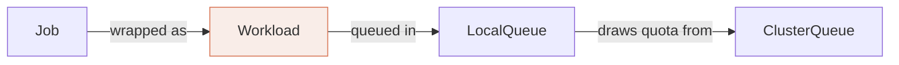

# Slide patterns

Figure recipes for each slot of the arc in SKILL.md, then the Markdown
fallback. Every figure lives in the template's `<svg class="fig" viewBox="0 0
960 440">` and uses its kit: `.box` groups (with `focus`, `ok`, `bad`, `ctx`,
`cell`), `.edge` paths (with `ok`, `bad`, `focus`), `.lbl` and `.sub` text,
`.group` containers, `.mk` markers, and `.dim` for build-up. Pull in only the
section you need. `example-bloom-filter.html` shows most of these in a real
deck.

Two layout habits make every recipe easier:

- **Draw edges first, boxes second**, so boxes paint over the arrow ends.
- **Lay out on a grid** in viewBox units (columns every 160 to 320, rows every
  110 to 150) and keep at least 40 units between boxes, so labels have room
  beside their arrows.

---

## 1. What is it  ·  contrast pair

**Answers:** what is this, in terms of something I already know?

**Figure:** two `.group` containers side by side, the familiar thing on the
left in `ctx` gray, the new thing on the right with its core part in `focus`
clay. Mirror the internals where they correspond, so the eye compares like
with like. One label under each side naming the decisive difference.

**Claim shape:** "X is like Y, except Z" or "X does Y with Z instead of W".

**Notes:** name the familiar thing explicitly, then the one difference that
matters. Resist listing every difference here: later slides carry them.

---

## 2. Why it exists  ·  before / after

**Answers:** what problem made someone build this?

**Figure:** the same small system drawn twice, left "without" and right
"with". On the left, mark the pain point in rust (a `bad` box, or a dashed
`bad` edge for the failure path). On the right, the new thing sits in clay
where the pain was, and the path turns olive.

**Claim shape:** "Without X, <pain>. With X, <relief>." or one sharper
sentence about the pain.

**Notes:** a concrete incident or number that makes the pain real, then why
the obvious fixes fall short. That gap is the reason the technology exists.

---

## 3. Parts  ·  module map

**Answers:** what are the pieces and how do they talk?

**Figure:** 4 to 7 boxes with verb-labeled edges. The component this deck is
about goes in clay at the center. Things it depends on or talks to go in
`ctx` gray around it. Group by process or by owner with a dashed `.group`.
This is the figure you will reuse with `.dim` for build-up, so place boxes
where they can stay put for the next slides.

**Claim shape:** one sentence about the architecture's key property (for
Kueue: "Kueue decides when a job starts, and kube-scheduler still decides
where its pods run").

**Notes:** one sentence per box, tied to markers. Name the real binaries,
CRDs, packages, or files.

For a dense system, see section 5 of
`../illustrate-with-html/references/patterns.md` (module map, critical path
highlighted), if that skill is installed.

---

## 4. How it works  ·  sequence, built up

**Answers:** what happens, step by step?

**Figure, option A, sequence:** lifelines as vertical gray lines with the
actor names on top, messages as horizontal edges labeled with verbs. Keep to
3 or 4 actors and 4 to 6 messages per slide.

**Figure, option B, build-up:** take the parts figure from slot 3, `.dim`
everything, then bring the boxes and edges of this step to full strength in
clay with numbered markers in order. Next slide: dim this step, light the
next.

**Figure, option C, state:** states as boxes, transitions as edges labeled
with the event that causes them. Terminal states in olive or rust.

**Claim shape:** one claim per step ("Admission reserves quota before any pod
exists").

**Notes:** walk the markers in order. Put the real API object, log line, or
command for each step in a `<pre>`. This is where the gotchas usually live.

---

## 5. Compared with alternatives  ·  columns or 2 x 2

**Answers:** how does this differ from what I would otherwise use?

**Figure, columns:** 2 or 3 cards side by side, one per alternative, with the
same rows in the same order (a row header column on the left). Values are
glyphs (✓ in olive, ✗ in rust) or two or three words. Put the deck's subject
in `focus` or the incumbent in `ctx`, whichever the claim is about.

**Figure, 2 x 2:** two axes that actually separate the options (for example
"scheduling unit" by "multi-tenant quota"), options placed as labeled dots.

**Claim shape:** the one difference that should drive the choice.

**Notes:** when each alternative wins. Fair comparisons build trust, so give
the alternatives their strongest case.

---

## 6. When to use it  ·  decision flow

**Answers:** should I use this for my problem?

**Figure:** 2 or 3 yes/no gates (diamonds or small boxes) leading to olive
"use it" and gray or rust "use something else" outcomes. Or a quadrant with
the sweet spot shaded clay.

**Claim shape:** "Use X when <condition>, and <alternative> otherwise".

**Notes:** the condition behind each gate, with a real example on both sides
of it.

---

## 7. Getting started  ·  numbered steps

**Answers:** what is the smallest thing I can run?

**Figure:** 3 to 5 boxes in a row, numbered with markers, each naming the
step in two or three words ("install CRDs", "create a queue", "submit a
job"). The commands do not go on the slide.

**Claim shape:** how small the first success is ("Three manifests get a job
admitted").

**Notes:** the exact commands and manifests in `<pre><code>`, copied from
the official quick start or the repo, with the version they apply to.

---

## 8. Summary  ·  the map again

**Answers:** what should I remember?

**Figure:** the parts figure or a recap of the deck's 3 or 4 key ideas as
boxes, each annotated with the slide number where it was explained.

**Claim shape:** when to reach for it, in one sentence.

**Notes:** a three-sentence recap, then a "to go deeper" list of the sources
used: official docs, specs, papers, the files read. Name each source so it can
be found even if a link breaks.

---

## Markdown with Mermaid (fallback)

When HTML is not wanted, write one Markdown file. Each slide is a level-2
heading holding the claim, one Mermaid block, then the notes as plain
paragraphs. A rule separates slides.

````markdown
# How Kueue admits workloads

## 1. Kueue admits whole workloads, not pods



**Notes.** Read left to right: ...

---

## 2. ...
````

Rules for the fallback:

- Same limits: one claim per heading, at most about seven nodes per diagram,
  verbs on edges, notes of 150 to 400 words.
- Keep Mermaid to `flowchart`, `sequenceDiagram`, and `stateDiagram-v2`, which
  render on GitHub, in Obsidian, and in most viewers.
- Use `classDef` for the clay focus color only. Mermaid styling varies by
  renderer, so do not rely on color alone to carry meaning.
- Markers do not exist in Mermaid. Refer to nodes by their label in the notes
  instead.
